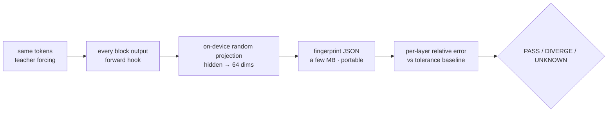

<div align="center">


**Your model now runs on a domestic GPU. Is it computing the right thing — and if not, from which layer on?**

*国产 GPU 上的大模型，逐层对照 — MetaX C500 · NVIDIA · CPU*

[](https://pypi.org/project/univis/)
[](https://github.com/cookiesheep/univis/actions/workflows/ci.yml)
[](tests)
[](https://www.python.org/downloads/)
[](docs/mxmaca/phase-b/README.md)
[](LICENSE)

**[▶ Try it online (no GPU)](https://cookiesheep.github.io/univis/play.html)** · [🎬 70-second film](https://cookiesheep.github.io/univis/#video) · [📑 Slides (PDF, Chinese)](https://cookiesheep.github.io/univis/assets/slides/UniVis.pdf) · [Gallery](https://cookiesheep.github.io/univis/) · [30-second start](#30-second-start-cpu-no-gpu) · [Evidence](#evidence) · [Support contract](#support-contract-and-scope) · [简体中文](README.md)

</div>

## Why

Move a model to another GPU, another software stack, another kernel library, or quantize it, and the output always changes a little. bf16 has error to begin with. The hard question is: **is this difference normal precision noise, or did a kernel in some layer go wrong?**

The final output cannot tell you. In the experiment below, a correct numeric stack and a stack with one wrong kernel in block 17 agree with the reference top-1 **equally: 96.2%**.

UniVis compares layer by layer. Both sides consume the same tokens, each layer's output leaves a tiny numeric fingerprint, and the fingerprints are compared into one of three verdicts:

| Verdict | Meaning |
|---|---|
| **PASS** | Every layer stays within 3× the error of a known-good implementation in the same precision |
| **DIVERGE** | Names the **first** layer whose error leaves the tolerance, and whether its attention or MLP output is to blame; look at those kernels |
| **UNKNOWN** | No tolerance baseline was given; abrupt jumps are ruled out, but "normal" is not claimed |

## 30-second start (CPU, no GPU)

```bash
pip install "univis[hf]"
univis diff demo
```

```
[1/3] fp32 reference: HuggingFaceTB/SmolLM2-135M on CPU
[2/3] bf16, correct (the tolerance baseline)
[3/3] bf16 with a wrong activation kernel in block 17

  correct bf16 : top-1 96.2%  (used as the tolerance baseline)
  broken  bf16 : top-1 96.2%  DIVERGE: error first exceeds the baseline error by 3.3x at block 17, MLP output (relative error 4.85e-02).

Same output-level agreement, but the layer view pinpoints the block.
Report: univis_diff_demo.html
```

The first run downloads SmolLM2-135M (about 270 MB); with the model cached it takes about 40 s on the CPU of an ordinary Windows PC. It runs the same model three times (fp32 reference, correct bf16, bf16 with block 17's activation swapped) and writes a self-contained HTML report ([open online](https://cookiesheep.github.io/univis/assets/reports/diff_cpu_demo.html)):

<div align="center">

</div>

## On your own model

```bash
# 1. reference: fp32 (CPU is fine)
univis diff record Qwen/Qwen2.5-0.5B-Instruct --dtype fp32 --device cpu -o ref.json

# 2. tolerance baseline: a known-good bf16 implementation, e.g. an NVIDIA GPU
univis diff record Qwen/Qwen2.5-0.5B-Instruct --dtype bf16 --tokens-from ref.json \
    -o nvidia.json --label "NVIDIA bf16"

# 3. candidate: e.g. MetaX C500
univis diff record Qwen/Qwen2.5-0.5B-Instruct --dtype bf16 --tokens-from ref.json \
    -o c500.json --label "MetaX C500 bf16"

# 4. compare layer by layer
univis diff compare ref.json c500.json --baseline nvidia.json -o report.html
```

- The three fingerprints can be recorded on three different machines and compared anywhere. Each is a JSON file of a few MB that can be opened, compared, and audited without a GPU.
- `--tokens-from` guarantees every side consumes exactly the same token ids.
- Exit codes `0` PASS, `1` DIVERGE, `3` UNKNOWN make it a drop-in CI regression check for stack upgrades and kernel swaps.

Python API:

```python
from univis import diff

ref = diff.record(model_fp32, tokenizer, label='fp32 reference')
cand = diff.record(model_on_c500, token_ids=ref['token_ids'], label='C500')
result = diff.compare(ref, cand, baseline=known_good)
print(result['verdict'], result['summary'])
diff.render_html(result, 'report.html')
```

## How it works



- **Teacher forcing**: both sides prefill the same tokens in one pass instead of generating, so one different greedy pick cannot shift everything after it. Positions align exactly.
- **On-device sketches**: inside the hook, each block output is projected to 64 dims by a fixed ±1 random matrix. The projection is linear, $P(a)-P(b)=P(a-b)$, so sketches stored on two machines are enough to estimate per-layer relative error without moving GB-sized activations. The matrix comes from SHAKE-256 and is identical on every machine.
- **Tolerance baseline**: the error of a known-good same-precision implementation against the reference is that precision's normal error. A candidate layer above 3× of it marks the divergence onset.
- **Sublayer attribution**: attention and MLP outputs are sketched too. Within the onset block, the sublayer that leaves tolerance first is the suspect; attention runs before the MLP, so it is blamed when both do.
- **Auditable without a GPU**: the verdict depends only on the fingerprint files, which anyone can re-check on a CPU.

## Evidence

### 1. One wrong kernel vs. precision noise (CPU, SmolLM2-135M)

| Candidate | Top-1 agreement with fp32 | UniVis layer verdict |
|---|---|---|
| bf16, correct stack | 96.2% | — (used as the tolerance baseline) |
| bf16, block 17 activation swapped (SiLU → tanh-GELU) | **96.2%** | **DIVERGE @ block 17, MLP output** (3.3× the baseline error) |

Reproduce with `univis diff demo` or [`examples/diff_fault_demo.py`](examples/diff_fault_demo.py). The fault is injected, so this only shows the mechanism works. C500 results are in the next section: everything tested passes, and we have not yet met a real kernel divergence on hardware.

### 2. MetaX C500, layer by layer

<div align="center">

</div>

Reference: NVIDIA RTX 5090 fp32; tolerance: RTX 5090 bf16; both sides consume identical tokens:

| Model · input | C500 attention | Verdict | Max per-layer ratio |
|---|---|---|---|
| Qwen2.5-0.5B / 3B / 7B · 8 prompts | sdpa | **all PASS** | 1.05 / 0.93 / 1.35 |
| Qwen2.5-0.5B / 3B · 3 × 1024 tokens | sdpa | **PASS** | ≤ 1.0 |
| Qwen2.5-0.5B / 3B · 3 × 1024 tokens | **MetaX flash-attn 2.6.3+metax** | **PASS** | ≤ 1.0 |

- **Within the tested scope, every layer of C500 bf16 stays within normal bf16 error**, including with MetaX's own flash-attention, which is also about 1.5× faster than sdpa on 1024 tokens.
- **The official image runs fp32 matmuls as TF32 by default** (`TORCH_ALLOW_TF32_CUBLAS_OVERRIDE=1`), error around $10^{-3}$; with TF32 off, C500 fp32 matches 5090 fp32 to about $10^{-5}$. Set it to `0` for strict fp32.
- Re-running on the same C500 gives bit-identical fingerprints.
- Lesson: the tolerance baseline must use **the same attention implementation** as the candidate; eager vs sdpa alone reaches about 3× (verified with a positive control).

All data, interactive reports, both environment fingerprints, and recording scripts: [docs/mxmaca/stage-c/](docs/mxmaca/stage-c/README.md).

### 3. Layer-level agreement between MetaX C500 and NVIDIA L20

Same model, prompts, and decoding protocol (greedy / bf16) on a MetaX C500 (16GB sGPU slice) and an NVIDIA L20; per-layer statistics collected on both sides and compared as profiles:

| Model | Arch | r (cosine profile) | r (Relative Delta profile) |
|---|---|---|---|
| Qwen2.5-0.5B | Qwen2 | 1.0000 | 1.0000 |
| Qwen2.5-3B | Qwen2 | 1.0000 | 1.0000 |
| Qwen2.5-7B | Qwen2 | 1.0000 | 1.0000 |
| TinyLlama-1.1B | Llama | 0.9968 | 0.9998 |

(10 mixed Chinese/English prompts covering translation, code, math, and common sense.)

<div align="center">
<table><tr>
<td width="33%"></td>
<td width="33%"></td>
<td width="33%"></td>
</tr></table>
<sub>MetaX C500 (magenta) and NVIDIA L20 (cyan) per-layer profiles nearly coincide.</sub>
</div>

On these models the MXMACA stack agrees with the NVIDIA stack at the level of per-layer statistics. Layer-averaged statistics are coarse; for per-position `univis diff` results, see section 2 above. Methodology, raw data, and environment fingerprints: [docs/mxmaca/phase-b/](docs/mxmaca/phase-b/README.md).

The same C500 session also drove a fix in UniVis itself: hook overhead fell from +400–486% (per-layer device syncs amplified) to about +55% (one batched transfer per step), with bit-identical metrics.

## Domestic compute and MXMACA

| Environment | Stack | Status |
|---|---|---|
| MetaX C500 (16GB sGPU slice) | torch 2.8.0+metax3.3.0.2, MACA 3.3.0.15, transformers 4.57.3 | ✅ collection path and cross-hardware comparison ([evidence](docs/mxmaca/phase-a/README.md)) |
| NVIDIA L20 (48GB) | torch 2.10.0+cu128, transformers 4.57.6 | ✅ incl. a 27B-class one-sided baseline |
| CPU | torch 2.x | ✅ all 94 tests, `univis diff demo`, offline reports |

| Stage | Goal | Status |
|---|---|---|
| A | C500 collection path, with environment fingerprint | ✅ 2026-08-19 |
| B | Cross-scale layer agreement, C500 vs NVIDIA | ✅ 2026-08-19 |
| C | `univis diff` on C500: Qwen2.5 0.5B / 3B / 7B all PASS against RTX 5090 layer by layer, incl. long sequences and MetaX flash-attn | ✅ 2026-10-30, [evidence](docs/mxmaca/stage-c/README.md) |
| C+ | Per-layer latency: find layers that are slow on C500 → swap in FlagGems / mcTriton kernels → verify accuracy with diff | planned |

## Support contract and scope

| Item | v0.7 contract |
|---|---|
| Models | HuggingFace `AutoModelForCausalLM` with auto-detected decoder blocks (GPT-2, LLaMA, Qwen, Mistral families); `demo` needs a LLaMA layout (`model.layers[i].mlp.act_fn`) |
| Inputs | 8 built-in Chinese/English, code, and math prompts, teacher-forced; `--tokens-from` reuses another side's token ids |
| Verdict | With a baseline: DIVERGE when a layer exceeds 3× the baseline error, else PASS. Without: only jumps (3×) after the first block are detected, and PASS is never given; the tolerance baseline should use the same attention implementation as the candidate |
| Estimate accuracy | 64-dim sketches estimated per-layer relative error within about 25% of the exact value in the CPU demo, enough for a 3× threshold; raise `--dim` for tighter estimates |
| Out of scope | Training and backward passes; task-level accuracy (use lm-eval, OpenCompass); "porting certified" claims; per-layer checks inside inference engines such as vLLM |

**PASS only means per-layer error stays within tolerance for the recorded model, prompt set, and stack. It does not extend to other models, sequence lengths, or shapes.**

## Redundancy profiling and live dashboard (existing features)

`univis.attach(model)` uses forward hooks to collect per-layer Relative Delta, input/output cosine similarity, and prediction entropy, and renders a live dashboard (React + ECharts) or a self-contained HTML report showing which layers change the representation least.

<table>
<tr>
<td width="50%" align="center"><br><sub>Model MRI: one ring per layer, orange = large change, grey-green = small</sub></td>
<td width="50%" align="center"><br><sub>Live per-layer heatmap of Qwen2.5-7B on MetaX C500</sub></td>
</tr>
</table>

```python
import univis

tracker = univis.attach(model)                       # blocks auto-detected
lp = tracker.logits_processor(tokenizer)
model.generate(input_ids, logits_processor=[lp], max_new_tokens=50)
report_path = tracker.finish()                       # self-contained HTML
```

CLI: `univis report` (JSONL → HTML), `univis compare` (multi-model), `univis serve` (live server; the dashboard runs from a clone with `npm run dev`).

<div align="center">

<br><sub>Qwen2.5-0.5B / 3B / 7B and Qwen3.6-27B (~54× parameter span): middle layers have the highest input/output cosine similarity, consistent with ShortGPT and related work.</sub>
</div>

## Lab notes (including negative results)

- **Skipping "redundant" layers does not work.** Skipping Qwen2.5-7B's middle layers because their cosine similarity is high raised perplexity from 13.81 to 105.67 (+665%). A saturated cosine does not mean a layer is useless (`examples/pilot_perplexity.py`).
- **Entropy-based early stopping truncates the answer.** Pilot forces end-of-sequence after N consecutive low-entropy steps. The saved tokens come from truncation, and "kept ratio" is the share of the original answer kept as a prefix, not a quality score. A per-token rule truncates at the very beginning; a consecutive-window rule gives a monotonic savings/kept curve (C500 data in [docs/mxmaca/phase-b/](docs/mxmaca/phase-b/README.md)). We do not recommend it as an inference speedup.

## Checkable facts

- Measured on two GPUs: MetaX C500 (MXMACA) and NVIDIA L20. Qwen2.5 0.5B / 3B / 7B and TinyLlama-1.1B were compared on both; Qwen3.6-27B on L20 only.
- The [gallery](https://cookiesheep.github.io/univis/) has 7 real-hardware reports (4 on C500, 3 on L20) and 1 CPU diff report, viewable in a browser without a GPU.
- C500 environment fingerprints (MXMACA versions, mx-smi output), raw JSONL, and reproduction scripts are in the repo: [docs/mxmaca/](docs/mxmaca/phase-a/README.md).
- Stage C environment fingerprint, per-layer results, and recording script: [docs/mxmaca/stage-c/](docs/mxmaca/stage-c/README.md).
- Both negative results are published in full (previous section).
- 94 unit tests run on GitHub Actions with Python 3.10 / 3.12.

## Architecture

```
your model ── univis.attach(model) ──▶ probe (forward hooks) ──▶ metrics ──▶ JSONL / WebSocket ──▶ Dashboard · HTML report
          └── univis diff record ──▶ teacher-forced pass ──▶ on-device sketches ──▶ fingerprint.json
                                                               univis diff compare ──▶ PASS / DIVERGE / UNKNOWN + HTML
```

```
src/univis/      Python SDK: detection · probe · metrics · transport · tracker · report · diff · pilot
dashboard/       React 18 + TypeScript + ECharts frontend
docs/mxmaca/     C500 evidence: environment fingerprints, raw data, comparison scripts
examples/        runnable examples (incl. diff_fault_demo.py)
tests/           94 unit tests
```

Module design: [ARCHITECTURE.md](ARCHITECTURE.md).

## Roadmap

- **Near term**: per-layer latency and the FlagGems kernel-swap loop (stage C+); full-tensor dumps of the diverging sublayer to produce a minimal repro for vendors.
- **Mid term**: before/after-quantization comparison (W8A8 / W4A16) that suggests which layers to keep in higher precision; 27B-class validation on a full C500.
- **Long term**: more domestic compute stacks; numeric regression checks wired into inference frameworks.

## Contributing

Issues and PRs are welcome: new model layouts, reference fingerprints recorded on your hardware, and report views are all valuable. See [CONTRIBUTING.md](CONTRIBUTING.md). If your model's output on a domestic GPU differs from NVIDIA, open an issue and we can localize it together with `univis diff`.

## License

[MIT](LICENSE)

## Acknowledgements

Thanks to the AI Systems group at Sun Yat-sen University for compute resources and technical discussions. Built on PyTorch, HuggingFace Transformers, FastAPI, React, and ECharts.
