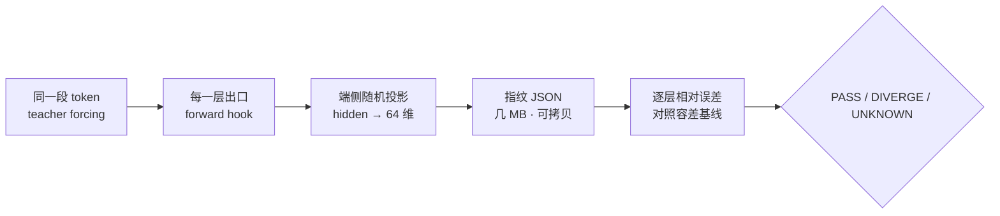

<div align="center">


**模型搬到国产 GPU 上以后，算得对不对？如果不对，从哪一层开始不对？**

*Find the first layer where two runs of the same model diverge — MetaX C500 · NVIDIA · CPU*

[](https://pypi.org/project/univis/)
[](https://github.com/cookiesheep/univis/actions/workflows/ci.yml)
[](tests)
[](https://www.python.org/downloads/)
[](docs/mxmaca/phase-b/README.md)
[](LICENSE)

**[▶ 在线体验（不用 GPU）](https://cookiesheep.github.io/univis/play.html)** · [🎬 60 秒影片](https://cookiesheep.github.io/univis/#film) · [📑 项目介绍 PDF](https://cookiesheep.github.io/univis/assets/slides/UniVis.pdf) · [官网](https://cookiesheep.github.io/univis/) · [30 秒上手](#30-秒上手cpu无需-gpu) · [实测证据](#实测证据) · [支持契约](#精确支持契约与范围声明) · [English](README.en.md)

</div>

## 为什么需要它

同一个模型换一块卡、换一版软件栈、换一个算子库，或者做了量化，输出总会有一点不同。bf16 本来就有误差，真正难的是判断：**这点不同是正常的精度误差，还是某一层的算子出了问题？**

只看最终输出分不出来。在下面的实验里，「数值栈完全正确」和「第 17 层有一个写错的算子」两种情况，与参考答案的 top-1 一致率**都是 96.2%**。

UniVis 把比较深入到每一层：两边喂同一段 token，在每一层出口记下一份很小的数值指纹，然后逐层对照，给出三种结论之一。

| 结论 | 含义 |
|---|---|
| **PASS** | 每一层的误差都在「已知正常的同精度实现」的 3 倍以内 |
| **DIVERGE** | 指出误差**第一次**超出容差的那一层，以及是这一层的 attention 还是 MLP，下一步就去查对应的算子 |
| **UNKNOWN** | 没有提供容差基线，只能排除层间突变，不下「正常」的结论 |

## 30 秒上手（CPU，无需 GPU）

```bash
pip install "univis[hf]"
univis diff demo
```

```
[1/3] fp32 reference: HuggingFaceTB/SmolLM2-135M on CPU
[2/3] bf16, correct (the tolerance baseline)
[3/3] bf16 with a wrong activation kernel in block 17

  correct bf16 : top-1 96.2%  (used as the tolerance baseline)
  broken  bf16 : top-1 96.2%  DIVERGE: error first exceeds the baseline error by 3.3x at block 17, MLP output (relative error 4.85e-02).

Same output-level agreement, but the layer view pinpoints the block.
Report: univis_diff_demo.html
```

首次运行会下载 SmolLM2-135M（约 270 MB）；模型缓存好以后，在一台普通 Windows 电脑的 CPU 上约 40 秒跑完。它把同一个模型跑三遍：fp32 参考、正确的 bf16、第 17 层激活函数被换错的 bf16，然后生成一份自包含 HTML 报告（[在线打开](https://cookiesheep.github.io/univis/assets/reports/diff_cpu_demo.html)）：

<div align="center">

</div>

## 用在你自己的模型上

```bash
# 1. 参考端：fp32（CPU 即可）
univis diff record Qwen/Qwen2.5-0.5B-Instruct --dtype fp32 --device cpu -o ref.json

# 2. 容差基线：一个已知正常的 bf16 实现，例如 NVIDIA GPU
univis diff record Qwen/Qwen2.5-0.5B-Instruct --dtype bf16 --tokens-from ref.json \
    -o nvidia.json --label "NVIDIA bf16"

# 3. 待检端：例如沐曦曦云 C500
univis diff record Qwen/Qwen2.5-0.5B-Instruct --dtype bf16 --tokens-from ref.json \
    -o c500.json --label "MetaX C500 bf16"

# 4. 逐层对照，出报告
univis diff compare ref.json c500.json --baseline nvidia.json -o report.html
```

- 三份指纹可以在三台不同的机器上录，拷到一起再比。每份是几 MB 的 JSON，没有 GPU 也能打开、比对和审计。
- `--tokens-from` 保证各端喂的是完全相同的 token id。
- 退出码 `0` PASS、`1` DIVERGE、`3` UNKNOWN，可以直接放进 CI，作为软件栈升级或算子替换的回归检查。

Python API：

```python
from univis import diff

ref = diff.record(model_fp32, tokenizer, label='fp32 reference')
cand = diff.record(model_on_c500, token_ids=ref['token_ids'], label='C500')
result = diff.compare(ref, cand, baseline=known_good)
print(result['verdict'], result['summary'])
diff.render_html(result, 'report.html')
```

## 它是怎么做的



- **teacher forcing**：两端喂同一段 token、一次 prefill 跑完，不让模型自己生成。避免了某一步贪心选词不同、后面整段错位的问题，逐位置对齐是严格的。
- **端侧草图**：在 hook 内部用一个固定的 ±1 随机矩阵把每层输出投影到 64 维。投影是线性的，$P(a)-P(b)=P(a-b)$，所以两台机器各存草图就能估计逐层相对误差，不需要搬运 GB 级的中间张量。投影矩阵由 SHAKE-256 生成，在任何机器上都完全相同。
- **容差基线**：同精度下「已知正常」的实现与参考之间的误差，就是该精度的正常误差。待检端某一层超过它的 3 倍，就判定从这一层开始分叉。
- **子层归因**：同时记录每层 attention 与 MLP 的输出草图。在分叉的那一层里，先超出容差的子层就是嫌疑对象；attention 先于 MLP 计算，两者都超出时归给 attention。
- **无卡可审计**：判定只依赖指纹文件，任何人都可以在 CPU 上复核。

## 实测证据

### 1. 单个错误算子 vs 正常精度误差（CPU，SmolLM2-135M）

| 待检端 | 与 fp32 参考的 top-1 一致率 | UniVis 逐层判定 |
|---|---|---|
| bf16，数值栈正确 | 96.2% | —（作为容差基线） |
| bf16，第 17 层激活函数换错（SiLU → tanh-GELU） | **96.2%** | **DIVERGE @ block 17，MLP 输出**（误差为基线的 3.3 倍） |

复现：`univis diff demo`，或 [`examples/diff_fault_demo.py`](examples/diff_fault_demo.py)。错误是人为注入的，只能说明机制成立；在真实适配问题上的检出能力，要靠 C500 实测来证明（见下方路线图阶段 C）。

### 2. 沐曦曦云 C500 真机：逐层对照

<div align="center">

</div>

参考为 NVIDIA RTX 5090 fp32，容差为 RTX 5090 bf16，两端输入逐 token 相同：

| 模型 · 输入 | C500 注意力实现 | 判定 | 每层最大倍数 |
|---|---|---|---|
| Qwen2.5-0.5B / 3B / 7B · 8 条提示词 | sdpa | **全部 PASS** | 1.05 / 0.93 / 1.35 |
| Qwen2.5-0.5B / 3B · 3 段 × 1024 token | sdpa | **PASS** | ≤ 1.0 |
| Qwen2.5-0.5B / 3B · 3 段 × 1024 token | **沐曦 flash-attn 2.6.3+metax** | **PASS** | ≤ 1.0 |

- **在所测范围内，C500 的 bf16 计算每一层都处于正常 bf16 误差之内**；换上沐曦自带的 flash-attention 后同样如此，而且处理 1024 token 比 sdpa 快约 1.5 倍。
- **官方镜像默认把 fp32 矩阵乘法按 TF32 执行**（`TORCH_ALLOW_TF32_CUBLAS_OVERRIDE=1`），误差约 $10^{-3}$；关掉后 C500 fp32 与 5090 fp32 只差 $10^{-5}$ 量级。需要严格 fp32 时把它设为 `0`。
- 同一台 C500 上重复运行，逐层指纹逐位一致。
- 方法教训：容差基线要和待检端用**同一种注意力实现**，否则 eager 对 sdpa 本身就会差到约 3 倍（已用阳性对照核实）。

全部数据、交互报告、两端环境指纹与录制脚本：[docs/mxmaca/stage-c/](docs/mxmaca/stage-c/README.md)。

### 3. 沐曦曦云 C500 与 NVIDIA L20 的层级一致性

同一模型、同一提示词、同一解码协议（greedy / bf16），在 MetaX 曦云 C500（16GB sGPU 切分）与 NVIDIA L20 上分别采集逐层统计量，比较两侧的层级画像：

| 模型 | 架构 | r（余弦画像） | r（Relative Delta 画像） |
|---|---|---|---|
| Qwen2.5-0.5B | Qwen2 | 1.0000 | 1.0000 |
| Qwen2.5-3B | Qwen2 | 1.0000 | 1.0000 |
| Qwen2.5-7B | Qwen2 | 1.0000 | 1.0000 |
| TinyLlama-1.1B | Llama | 0.9968 | 0.9998 |

（10 条中英混合提示词，含翻译、代码、数学、常识。）

<div align="center">
<table><tr>
<td width="33%"></td>
<td width="33%"></td>
<td width="33%"></td>
</tr></table>
<sub>沐曦 C500（品红）与 NVIDIA L20（青）的逐层画像几乎重合。</sub>
</div>

这说明在这些模型上，MXMACA 栈的逐层计算与 NVIDIA 栈在统计意义上一致。层平均统计量的粒度较粗，逐位置的 `univis diff` 对照是阶段 C 的内容。方法学、原始数据和环境指纹见 [docs/mxmaca/phase-b/](docs/mxmaca/phase-b/README.md)。

同一轮 C500 实测还推动了工具自身的一次修复：hook 采集开销从旧实现的 +400~486%（逐层设备同步被放大）降到 +55% 量级（每步一次批量回传），指标逐位不变。

## 国产算力与 MXMACA

| 环境 | 软件栈 | 状态 |
|---|---|---|
| MetaX 曦云 C500（16GB sGPU 切分） | torch 2.8.0+metax3.3.0.2、MACA 3.3.0.15、transformers 4.57.3 | ✅ 采集通路与跨硬件对照已验证（[证据](docs/mxmaca/phase-a/README.md)） |
| NVIDIA L20（48GB） | torch 2.10.0+cu128、transformers 4.57.6 | ✅ 已验证，含 27B 级单侧基线 |
| CPU | torch 2.x | ✅ 全部 94 项测试、`univis diff demo`、离线报告 |

| 阶段 | 目标 | 状态 |
|---|---|---|
| A | C500 指标采集通路验证（含环境指纹） | ✅ 2026-08-19 |
| B | C500 与 NVIDIA 跨规模层级一致性 | ✅ 2026-08-19 |
| C | C500 上的 `univis diff`：Qwen2.5 0.5B / 3B / 7B 对 RTX 5090 逐层全部 PASS，含长序列与沐曦 flash-attn | ✅ 2026-10-30，[证据](docs/mxmaca/stage-c/README.md) |
| C+ | 逐层耗时对照：找出在 C500 上偏慢的层 → 换上 FlagGems / mcTriton 算子 → 用 diff 验证精度不变 | 计划中 |

## 精确支持契约与范围声明

| 项 | v0.7 契约 |
|---|---|
| 模型 | HuggingFace `AutoModelForCausalLM`，decoder block 自动识别（GPT-2、LLaMA、Qwen、Mistral 系）；`demo` 需要 LLaMA 结构（`model.layers[i].mlp.act_fn`） |
| 输入 | 内置 8 条中英文、代码、数学提示词，teacher forcing；可用 `--tokens-from` 复用另一端的 token id |
| 判定 | 有基线：某层误差超过基线误差 3 倍即 DIVERGE，否则 PASS；无基线：只检测第 1 个 block 之后的层间突变（3 倍），给不出 PASS；容差基线应与待检端使用同一种注意力实现 |
| 估计精度 | 64 维草图对单层相对误差的估计，在 CPU 演示中与精确值最多相差约 25%，对 3 倍阈值足够；需要更紧可加大 `--dim` |
| 不做什么 | 训练与反向传播；任务级精度评测（请用 lm-eval、OpenCompass）；「适配合格」认证；vLLM 等推理引擎内部的逐层检查 |

**PASS 只说明在所记录的模型、提示词集和软件栈上逐层误差处于容差内，不外推到其他模型、序列长度或 shape。**

## 冗余画像与实时 Dashboard（原有功能，继续可用）

`univis.attach(model)` 用 forward hook 逐层采集 Relative Delta、层间余弦相似度、预测熵等标量，输出实时 Dashboard（React + ECharts）或自包含 HTML 报告，回答「推理时哪些层的改动最小」。

<table>
<tr>
<td width="50%" align="center"><br><sub>模型 MRI：每层一圈，橙色改动大、灰绿色改动小</sub></td>
<td width="50%" align="center"><br><sub>Qwen2.5-7B 在曦云 C500 上实时推理的逐层热力图</sub></td>
</tr>
</table>

```python
import univis

tracker = univis.attach(model)                       # 自动识别 block
lp = tracker.logits_processor(tokenizer)
model.generate(input_ids, logits_processor=[lp], max_new_tokens=50)
report_path = tracker.finish()                       # 自包含 HTML 报告
```

命令行：`univis report`（JSONL → HTML）、`univis compare`（多模型对比）、`univis serve`（实时服务，Dashboard 需克隆仓库后 `npm run dev`）。

<div align="center">

<br><sub>Qwen2.5-0.5B / 3B / 7B 与 Qwen3.6-27B（约 54 倍参数跨度）：中段层的输入输出余弦相似度最高，与 ShortGPT 等工作的观察一致。</sub>
</div>

## 实验记录（含负结果）

- **跳过「冗余层」不成立。**按「余弦相似度高就跳过」的直觉跳过 Qwen2.5-7B 的中段层，perplexity 从 13.81 升到 105.67（+665%）。余弦饱和不等于这一层没用，直接跳层不可取（`examples/pilot_perplexity.py`）。
- **按熵提前结束生成，本质是截短回答。**Pilot 在预测熵连续 N 步低于阈值时强制输出结束符。节省的 token 来自截断；所谓「保留率」，指截断后的前缀与原回答一致的比例，并不是质量分。朴素的逐 token 判据会在答案开头就截断，连续窗口判据可以得到单调的「节省—保留」曲线（C500 实测数据见 [docs/mxmaca/phase-b/](docs/mxmaca/phase-b/README.md)）。我们不把它推荐为推理加速手段。

## 可复核的事实

- 两种 GPU 真机实测：沐曦曦云 C500（MXMACA）与 NVIDIA L20。Qwen2.5 0.5B / 3B / 7B 和 TinyLlama-1.1B 做了两侧对照，Qwen3.6-27B 为 L20 单侧。
- [官网](https://cookiesheep.github.io/univis/)里有 7 份真机报告（C500 4 份、L20 3 份）和 1 份 CPU diff 报告，浏览器直接打开，不需要 GPU。
- C500 环境指纹（MXMACA 版本、mx-smi 输出）、原始 JSONL 和复现脚本全部入库：[docs/mxmaca/](docs/mxmaca/phase-a/README.md)。
- C500 阶段 C 的环境指纹、逐层结果与录制脚本：[docs/mxmaca/stage-c/](docs/mxmaca/stage-c/README.md)。
- 两例负结果完整公开（见上一节）。
- 94 项单元测试，GitHub Actions 在 Python 3.10 / 3.12 上全量运行。

## 架构

```
your model ── univis.attach(model) ──▶ probe (forward hooks) ──▶ metrics ──▶ JSONL / WebSocket ──▶ Dashboard · HTML report
          └── univis diff record ──▶ teacher-forced pass ──▶ on-device sketches ──▶ fingerprint.json
                                                               univis diff compare ──▶ PASS / DIVERGE / UNKNOWN + HTML
```

```
src/univis/      Python SDK：detection · probe · metrics · transport · tracker · report · diff · pilot
dashboard/       React 18 + TypeScript + ECharts 前端
docs/mxmaca/     C500 证据链：环境指纹、原始数据、对照脚本
examples/        可运行示例（含 diff_fault_demo.py）
tests/           94 项单元测试
```

模块设计见 [ARCHITECTURE.md](ARCHITECTURE.md)。

## 路线图

- **近期**：C500 上的 `univis diff` 参考指纹（阶段 C）；逐层耗时对照与 FlagGems 算子替换闭环（阶段 C+）；对分叉子层保存完整张量，自动生成可交给厂商的最小复现。
- **中期**：量化前后的逐层对照（W8A8 / W4A16），输出建议保留高精度的层；27B 级 C500 整机验证。
- **远期**：更多国产算力栈；对接推理框架的数值回归检查。

## 参与贡献

欢迎提交 issue 和 PR：新的模型结构适配、在你自己硬件上录制的参考指纹、报告视图，都很有价值。参见 [CONTRIBUTING.md](CONTRIBUTING.md)。如果你在国产 GPU 上遇到「输出和 NVIDIA 不一样」的问题，欢迎开 issue，我们可以一起用 `univis diff` 定位。

## 许可证

[MIT](LICENSE)

## 鸣谢

感谢中山大学 AI Systems 研究组提供的算力资源与技术讨论。本项目基于 PyTorch、HuggingFace Transformers、FastAPI、React、ECharts 构建。
