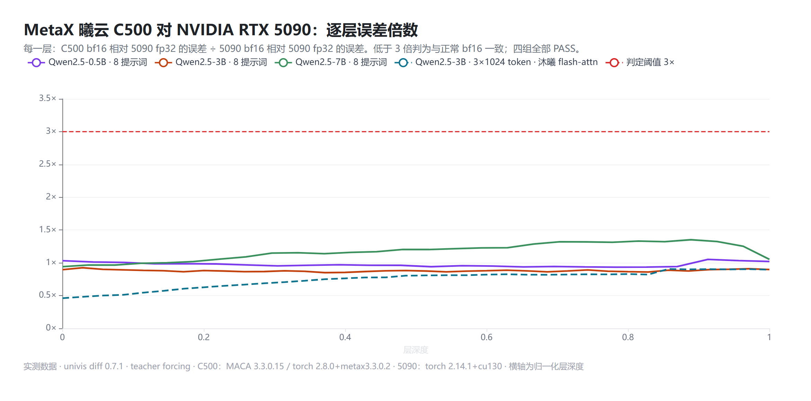

# 阶段 C：MetaX 曦云 C500 上的 `univis diff`

**状态：已完成（2026-10-30）。**C500 侧录了 Qwen2.5-0.5B / 3B / 7B-Instruct 的指纹，并补充了长序列和三种注意力实现；NVIDIA 侧在 RTX 5090 上用**完全相同的 token** 录了 fp32 参考和 bf16 容差基线。



## 结论一：C500 的 bf16 计算在每一层都处于正常 bf16 误差范围内

参考为 RTX 5090 fp32（关闭 TF32），容差为 RTX 5090 bf16；倍数 = C500 bf16 的误差 ÷ 5090 bf16 的误差，超过 3 倍才判为分叉。

| 模型 | 输入 | 注意力实现（C500） | 判定 | 每层最大倍数 | top-1 一致率（C500 / 5090 bf16） |
|---|---|---|---|---|---|
| Qwen2.5-0.5B | 8 条提示词，145 个位置 | sdpa | **PASS** | 1.05 | 97.2% / 98.6% |
| Qwen2.5-3B | 同上 | sdpa | **PASS** | 0.93 | 97.9% / 97.9% |
| Qwen2.5-7B | 同上 | sdpa | **PASS** | 1.35 | 95.2% / 95.9% |
| Qwen2.5-0.5B | 3 段 × 1024 token | sdpa | **PASS** | ≤ 1.0 | 98.8% / 98.8% |
| Qwen2.5-0.5B | 同上 | **沐曦 flash-attn 2.6.3+metax** | **PASS** | ≤ 1.0 | 98.9% / 98.8% |
| Qwen2.5-3B | 同上 | sdpa | **PASS** | ≤ 1.0 | 99.2% / 99.1% |
| Qwen2.5-3B | 同上 | **沐曦 flash-attn 2.6.3+metax** | **PASS** | ≤ 1.0 | 99.3% / 99.1% |
| Qwen2.5-3B | 同上 | eager | **PASS** | 1.87 | 99.3% / 99.1% |

在这些模型、输入和软件栈上，没有发现任何一层超出正常 bf16 误差。换上沐曦自带的 flash-attention 以后，逐层精度同样在容差之内；在这块 16GB 切分（25% 算力）上，它处理 1024 token 比 sdpa 快约 1.5 倍（3B：74 ms 对 109 ms；0.5B：29 ms 对 43 ms）。

## 结论二：官方镜像默认把 fp32 矩阵乘法按 TF32 执行

| C500 fp32 设置 | 对 5090 fp32 的末层相对误差 | top-1 |
|---|---|---|
| 关闭 TF32 | 6.2e-6（0.5B）、3.8e-5（3B） | 100% |
| 镜像默认（TF32 开启） | 1.7e-3（0.5B）、8.0e-4（3B） | 99.3%（0.5B）、100%（3B） |

环境指纹里 `torch.backends.cuda.matmul.allow_tf32 = True`、`TORCH_ALLOW_TF32_CUBLAS_OVERRIDE=1`，而 NVIDIA 上 PyTorch 的默认值是关闭（5090 侧 `allow_tf32 False`）。沐曦的 MXMACA 发布说明「已知问题」里也提到过这个变量。需要严格 fp32 时（例如把 C500 当精度参考），这样关掉：

```bash
export TORCH_ALLOW_TF32_CUBLAS_OVERRIDE=0
```
```python
torch.backends.cuda.matmul.allow_tf32 = False
torch.backends.cudnn.allow_tf32 = False
```

## 结论三：同一台 C500 上重复运行逐位一致

在 1024 token 长序列上，sdpa 路径连续跑两遍，0.5B 和 3B 的所有层指纹逐位相同。也就是说，上面的误差全部来自硬件和软件栈之间的差异，没有混入运行间的随机波动。

## 方法上的一条教训：容差基线要和待检端用同一种注意力实现

C500 用 eager 注意力跑 0.5B 长序列时，如果拿 5090 的 **sdpa** bf16 作容差，block 0 的 MLP 输出会冲到 3.00 倍，被判为 DIVERGE。我们做了阳性对照来核实：
- 换成 5090 的 **eager** bf16 作容差后，C500 eager 判为 **PASS**（最大 1.02 倍）；
- 在 5090 自己身上，eager 对 sdpa 基线也会到 2.95 倍。

所以那次报警来自「eager 和 sdpa 的累加顺序不同」，和 C500 无关。之后的支持契约里写明：**容差基线应与待检端使用同一种注意力实现。**

## 初步对照（已被上面的正式结果取代）

在 NVIDIA 基线录好之前，我们先用 x86 CPU 作过参考和容差（[results_0.5B.json](results_0.5B.json)、[c500-layer-error.png](c500-layer-error.png)）。当时 0.5B 的结论同样是 PASS（每层 1.00–1.04 倍），与正式结果一致。

## 环境

| 项 | MetaX 侧 | NVIDIA 侧 |
|---|---|---|
| 硬件 | 曦云 C500，16GB sGPU 切分（25% 算力），模力方舟按量实例 | GeForce RTX 5090 32GB |
| 软件栈 | MACA 3.3.0.15、驱动 3.8.30、torch 2.8.0+metax3.3.0.2、transformers 4.57.3 | 驱动 580.65.06、torch 2.14.1+cu130、transformers 5.20.2 |
| 指纹 | [env-fingerprint.txt](env-fingerprint.txt) | [nvidia-env-fingerprint.txt](nvidia-env-fingerprint.txt) |

工具为 univis 0.7.1 的 `univis diff record`（64 维草图，含 attention / MLP 子层）。所有对照都用 `--tokens-from` 复用 C500 录下的 token id，两端输入逐 token 相同。

## 文件

- `results_xhw.json`：全部对照的判定、逐层倍数、top-1；`results_0.5B.json`：早先的 CPU 参考对照
- `report_c500_vs_5090_{0.5B,3B,7B}.html`、`report_c500_flash_long_{0.5B,3B}.html`：`univis diff compare` 交互报告
- `stage_c_c500.sh`、`stage_c_extra.py`、`stage_c_nvidia.sh`：两端的录制脚本
- 原始指纹（C500 与 NVIDIA 两端共约 0.6 GB）暂由维护者保存，计划作为 Release 附件公开

## 范围声明

- 结论只覆盖上述三个模型、两组输入（8 条短提示词、3 段 1024 token）、bf16 精度和上述软件栈，不外推到其他模型、更长序列、其他 shape 或其他 MXMACA 版本。
- 两端的 transformers 版本不同（4.57.3 对 5.20.2）。参考和容差都来自 NVIDIA 同一环境，判定比较的是「C500 偏离参考的程度」与「NVIDIA 自身 bf16 偏离参考的程度」，所以版本差异会被一并计入 C500 一侧，结论只会偏保守。
- 7B 本轮没有录长序列和 flash-attention 对照（7B 权重已占去 16GB 切分的大部分显存，未尝试）。
- 逐层计时（阶段 C+）目前只验证了 `torch.cuda.Event` 在 C500 上可用；FlagGems 未预装，闭环留待后续。
