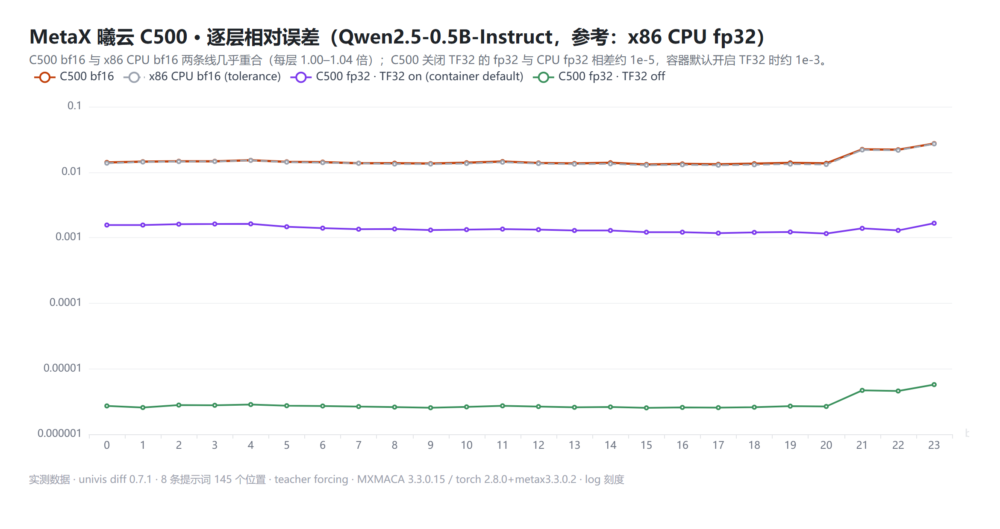

# 阶段 C：MetaX 曦云 C500 上的 `univis diff`

**状态：进行中（2026-10-30）。**C500 侧指纹已全部录完（Qwen2.5-0.5B / 3B / 7B-Instruct）。NVIDIA 侧的参考与容差基线待补录；在此之前，0.5B 的跨硬件对照**暂以 x86 CPU 作参考与容差基线**，属初步结论。



## 结论（Qwen2.5-0.5B-Instruct，参考：x86 CPU fp32）

| 待检端 | 末层相对误差 | top-1 与参考一致率 | `univis diff` 判定 |
|---|---|---|---|
| C500 bf16 | 2.73e-2 | 97.2% | **PASS**：每层误差为 x86 CPU bf16 的 1.00–1.04 倍 |
| x86 CPU bf16（容差基线） | 2.70e-2 | 97.9% | — |
| C500 fp32，TF32 关闭 | **5.73e-6** | 100% | 与 CPU fp32 几乎逐位一致 |
| C500 fp32，容器默认（TF32 开启） | 1.66e-3 | 99.3% | 约为关闭 TF32 时的 290 倍 |

两点结论：

1. **C500 的 bf16 计算在每一层都处于正常 bf16 误差范围内。**它与一个已知正常的 bf16 实现（x86 CPU）的误差曲线逐层重合，没有出现分叉层。
2. **该官方镜像默认把 fp32 矩阵乘法按 TF32 执行。**环境指纹里 `torch.backends.cuda.matmul.allow_tf32 = True`、`TORCH_ALLOW_TF32_CUBLAS_OVERRIDE=1`，而 NVIDIA 上 PyTorch 的默认值是关闭。沐曦的 MXMACA 发布说明的「已知问题」里也提到过这个变量。需要严格 fp32 结果时（例如拿 C500 做精度参考），可以这样关掉：
   ```bash
   export TORCH_ALLOW_TF32_CUBLAS_OVERRIDE=0
   ```
   ```python
   torch.backends.cuda.matmul.allow_tf32 = False
   torch.backends.cudnn.allow_tf32 = False
   ```
   关掉后，C500 fp32 与 x86 CPU fp32 的末层相对误差为 5.73e-6。

C500 内部对照（参考：C500 严格 fp32）：TF32 带来的逐层误差约为 bf16 误差的十分之一（中位数：0.5B 为 0.10、3B 为 0.07，最大 0.12）。3B 上 TF32 的 top-1 一致率为 100%，0.5B 为 99.3%。

## 环境

| 项 | 值 |
|---|---|
| 硬件 | MetaX 曦云 C500，16GB sGPU 切分（25% 算力），模力方舟按量实例 |
| 软件栈 | MACA 3.3.0.15、驱动 3.8.30、torch 2.8.0+metax3.3.0.2、transformers 4.57.3、Python 3.10 |
| 参考端 | x86 CPU（Windows），torch 2.15.0+cpu |
| 工具 | univis 0.7.1，`univis diff record`，64 维草图，含 attention / MLP 子层 |
| 输入 | 内置 8 条中英文、代码、数学提示词，teacher forcing，145 个位置 |

完整环境指纹见 [env-fingerprint.txt](env-fingerprint.txt)，录制脚本见 [stage_c_c500.sh](stage_c_c500.sh)。C500 上从安装到录完三个规模（含两组 fp32）共用约 13 分钟。

## 文件

- `results_0.5B.json`：四条曲线的逐层相对误差、top-1 一致率、判定结果
- `report_c500_vs_cpu_0.5B.html`：`univis diff compare` 的交互报告（C500 bf16 对 CPU fp32，容差为 CPU bf16）
- 原始指纹（9 份，约 38 MB）暂由维护者保存，计划作为 Release 附件公开

## 顺带探索（结论仅为探索）

- 在 C500 上可以用 `torch.cuda.Event` 计时，逐层耗时对照（阶段 C+）技术上可行。
- 该镜像未预装 FlagGems；按规范不在镜像内额外安装，FlagGems 闭环留待后续。

## 范围声明

- 结论只覆盖上述模型、提示词集、序列长度和软件栈，不外推。
- 0.5B 的容差基线是 x86 CPU bf16，不是 NVIDIA GPU。CPU 与 GPU 的 bf16 kernel 实现不同，所以这只能算初步结论；NVIDIA 基线补录后会更新本页。
- 3B / 7B 的 C500 指纹已录，跨硬件对照等 NVIDIA 侧补录后给出。
